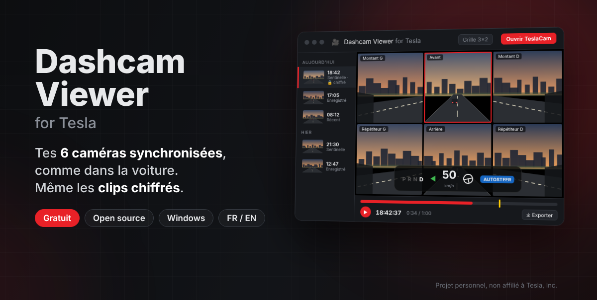

# Dashcam Viewer for Tesla

🇬🇧 [English](README.md) · 🇫🇷 **Français**



Lecteur Windows pour les clips **Dashcam / Sentinelle** enregistrés par une Tesla sur clé USB : les 6 caméras synchronisées, comme dans la voiture, y compris les **clips chiffrés** (logiciel Tesla 2026.20+).

> Projet personnel, **non affilié à Tesla, Inc.** « Tesla », « TeslaCam » et « Sentry Mode » sont des marques de Tesla, Inc.

## Fonctionnalités

- **6 caméras synchronisées** (avant, arrière, montants, répétiteurs), plusieurs dispositions : *grille 3×2* (comme dans la voiture), *avant + arrière*, *une caméra en grand*.
- **Export vidéo**, selon la vue affichée :
  - *une caméra en grand* → cette caméra enregistrée en **un seul MP4 pour tout l'événement, sans réencodage** (qualité d'origine, quelques secondes, déchiffrée si le clip l'était) ;
  - *grille 3×2* ou *avant + arrière* → **une vidéo mosaïque** des 6 caméras disposées comme à l'écran, avec date/heure et télémétrie incrustées au choix, en Full HD (idéal téléphone) ou 4K. Encodage dans l'application (H.264 via WebCodecs), sans logiciel supplémentaire.
- **Deux modes d'export** qui décident de ce que le fichier révèle :
  - 🛡️ **Assurance / constat** → un dossier avec la vidéo (date, lieu, GPS et état du véhicule dans un bandeau sous l'image), les **clips d'origine non modifiés** (déchiffrés, sans réencodage), une **fiche PDF** (lieu, état du véhicule au moment de l'événement, moments détectés, capture des 6 caméras) et les **empreintes SHA-256** de chaque fichier ;
  - 📱 **Réseaux sociaux** → **plaques d'immatriculation floutées par une IA locale**, aucun lieu, vitesse masquée, et la télémétrie de Tesla — **position GPS comprise** — absente du fichier.
- **Résumé factuel** (bouton 📝 et dans la fiche PDF de l'assurance) : des phrases simples rédigées uniquement à partir des données de la voiture — date, lieu, vitesse, rapport, aide à la conduite, frein, clignotants, moments détectés. Une phrase n'apparaît que si toutes ses données sont disponibles, et le lieu ou la vitesse peuvent être retirés. En français et en anglais. Aucune IA.
- **Clips chiffrés** : déchiffrement **local et à la volée** (seul ce qui est regardé est déchiffré, rien n'est écrit en clair sur le disque).
- **Télémétrie** embarquée par Tesla dans la vidéo : vitesse, rapport, angle du volant, accélérateur, frein, clignotants, Autosteer / FSD, et l'**accélération ressentie (g)**.
- **Moments détectés** sur la timeline : 🛑 freinage brusque, ↪️ virage serré, 💥 secousse ou choc, 🔵 aide à la conduite désactivée — un clic pour y aller.
- **Repère de l'événement** sur la timeline, vignettes, filtres Enregistrés / Sentinelle / Récents, raccourcis clavier.
- **Interface en français / anglais**, selon la langue de Windows, modifiable à tout moment.

## Confidentialité

- Les vidéos **ne quittent jamais le PC**.
- Pour un clip chiffré, seules ses **métadonnées de clé** (en-tête de ~200 octets) sont envoyées à `dashcam.tesla.com`, qui renvoie la clé du clip — exactement ce que fait le lecteur officiel de Tesla.
- La connexion se fait sur la **vraie page Tesla**, dans une fenêtre de l'appli : le mot de passe ne va qu'à Tesla. Le jeton de session reste en mémoire.
- Les clés reçues sont conservées **chiffrées par Windows (DPAPI)** : un clip déverrouillé une fois se relit hors connexion.
- **Une exception, désactivable** : en mode assurance, si la voiture n'a pas noté l'adresse (clips chiffrés, clips Récents), la commune et la route sont demandées **une seule fois** à OpenStreetMap (Nominatim), qui reçoit alors cette position GPS. Décoche l'option pour tout garder hors ligne : la fiche n'affiche alors que les coordonnées.
- L'export d'une caméra conserve la télémétrie de Tesla, **position GPS comprise**, sauf avec le mode réseaux sociaux.
- **Le floutage des plaques se fait entièrement sur ton PC.** La première fois, le modèle de détection (8 Mo, [open-image-models](https://github.com/ankandrew/open-image-models), licence MIT) est téléchargé une seule fois depuis GitHub et vérifié par son empreinte SHA-256 ; aucune image n'est envoyée nulle part.

## Limites connues

- Le déchiffrement repose sur l'**API non documentée** du lecteur web de Tesla : une évolution côté Tesla peut le casser.
- Dans `EncryptedClips`, `event.json` et `thumb.png` ne contiennent pas de métadonnées de clé : seule la voiture peut les lire. Le moment de l'événement est alors déduit du nom du dossier (≈ quelques secondes près) et la vignette est prise dans la vidéo.
- Mesuré sur de vrais clips (logiciel d'avril 2026) : la gravité est déjà retirée, x est l'axe latéral (+ à droite) et y l'axe longitudinal au signe inversé (+ au freinage). La conduite normale est restée sous 0,45 g, sans fausse alerte.
- L'export en mosaïque réencode chaque image : il utilise la carte graphique quand elle est disponible mais reste bien plus lent que l'export d'une caméra, surtout en 4K.
- La télémétrie n'existe que sur les clips récents (logiciel 2025.44.25+, HW3+) et pas quand la voiture est garée : pas de G-force ni de moments détectés sur un événement Sentinelle à l'arrêt.
- **Le floutage des plaques n'est pas parfait** : une plaque vue très de biais, très loin ou dans le noir peut être manquée. Regarde la vidéo avant de la publier. Les visages ne sont pas floutés. Le floutage oblige à réencoder la vidéo et rend l'export plusieurs fois plus lent (la carte graphique est utilisée via DirectML quand c'est possible).
- Tesla ne documente pas les axes de son accéléromètre : la G-force est l'écart par rapport à la valeur habituelle de chaque clip, et les freinages et virages sont calculés à partir de la vitesse et du cap GPS. Les seuils sont indicatifs.
- L'exécutable n'est pas signé : Windows SmartScreen demande une confirmation au premier lancement.

## Installation

Depuis la [dernière release](../../releases/latest) :

- **`…-Setup.exe`** (conseillé) : le lancer, l'application s'installe pour ton compte (sans droits administrateur) avec un raccourci sur le Bureau et dans le menu Démarrer. Désinstallation depuis *Paramètres → Applications*.
- **`…-win64.zip`** : sans installation — le dézipper et lancer `Dashcam Viewer for Tesla.exe`.

Le logiciel n'est pas signé : au premier lancement, Windows SmartScreen affiche un avertissement → *Informations complémentaires* → *Exécuter quand même*.

## Développement

```bash
npm install
npm start          # lancer en développement
npm run package    # construire l'application Windows (dist/)
npm run installer  # puis le Setup.exe (dist/installer/) — sous Windows, ou Linux avec wine
npm test           # tests du déchiffrement (TCV_SAMPLES=chemin/vers/TeslaCam)
node test/make-synthetic.js   # clips synthétiques 6 caméras pour le test d'export (ffmpeg requis)
```

Raccourcis : `Espace` lecture · `←/→` ±5 s (`Maj` ±1 s) · `1`–`6` caméra · `G` disposition · `T` télémétrie · `E` événement · `↑/↓` événement précédent/suivant · `F` plein écran · `Échap` vue par défaut.

## Crédits

- Détection des plaques : modèle YOLOv9 de [ankandrew/open-image-models](https://github.com/ankandrew/open-image-models) (MIT), exécuté avec [ONNX Runtime](https://onnxruntime.ai/) (MIT).

- Format du conteneur chiffré et de l'appel de clés : travaux de rétro-ingénierie publiés par [steiner-dominik/tesla-dashcam-decrypt](https://github.com/steiner-dominik/tesla-dashcam-decrypt), [crstian19/tesla-dashcam-decrypt-go](https://github.com/crstian19/tesla-dashcam-decrypt-go) et [pieczorx/tesla-manager](https://github.com/pieczorx/tesla-manager).
- Lecture, assemblage et écriture MP4 des vidéos : [Mediabunny](https://mediabunny.dev/) (MPL-2.0).
- Format de la télémétrie : [`dashcam.proto`](https://github.com/teslamotors/dashcam) publié par Tesla.

## Publier une version

1. Ajouter la section de la version dans [CHANGELOG.md](CHANGELOG.md) (français + anglais) et pousser.
2. Sur GitHub : *Releases → Draft a new release*, nouveau tag (ex. `v0.4.0`), description vide, *Publish*.
3. GitHub Actions construit l'application sous Windows, l'attache à la release et remplit la description à partir du CHANGELOG.

## Licence

MIT — voir [LICENSE](LICENSE).
