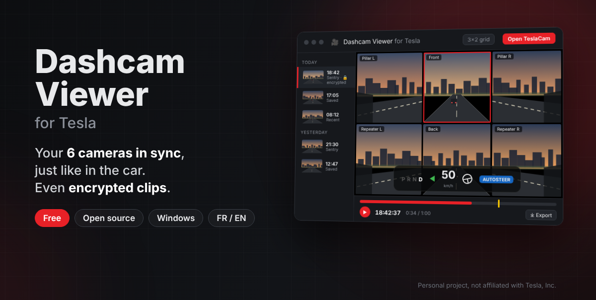

# Dashcam Viewer for Tesla

🇬🇧 **English** · 🇫🇷 [Français](README.fr.md)



A Windows player for the **Dashcam / Sentry Mode** clips a Tesla records on its USB drive: all 6 cameras in sync, just like in the car — including **encrypted clips** (Tesla software 2026.20+).

> Personal project, **not affiliated with Tesla, Inc.** "Tesla", "TeslaCam" and "Sentry Mode" are trademarks of Tesla, Inc.

## Features

- **6 synchronized cameras** (front, rear, pillars, repeaters) with several layouts: *3×2 grid* (like in the car), *front + rear*, *one large camera*.
- **Video export**, depending on the current view:
  - *one large camera* → that camera saved as **one MP4 for the whole event, with no re-encoding** (original quality, takes seconds, decrypted if the clip was encrypted);
  - *3×2 grid* or *front + rear* → **one mosaic video** of the 6 cameras laid out as on screen, with date/time and optional telemetry burned in, in Full HD (phone-friendly) or 4K. Encoded inside the app (H.264 via WebCodecs), no extra software.
- **Two export presets** that decide what the file reveals:
  - 🛡️ **Insurance / claim** → a folder with the video (date, place, GPS and vehicle state in a band under the picture), the **untouched original clips** (decrypted, not re-encoded), a **PDF report** (place, vehicle state at the event, detected moments, snapshot of the 6 cameras) and **SHA-256 fingerprints** of every file;
  - 📱 **Social media** → **licence plates blurred by a local AI**, no place, speed hidden, and Tesla's telemetry — **GPS position included** — left out of the file.
- **Factual summary** (📝 button and in the insurance PDF): plain sentences written only from the car's data — date, place, speed, gear, driver assistance, brake, turn signals, detected moments. A sentence only appears when all its data is available, and place or speed can be left out. French and English. No AI involved.
- **Encrypted clips**: **local, on-the-fly** decryption — only what you watch gets decrypted, nothing is ever written to disk in clear.
- **Telemetry** that Tesla embeds in the video: speed, gear, steering angle, accelerator, brake, turn signals, Autosteer / FSD, and the **felt acceleration (g)**.
- **Detected moments** on the timeline: 🛑 hard braking, ↪️ sharp turn, 💥 jolt or impact, 🔵 driver assistance switched off — click one to jump there.
- **Event marker** on the timeline, thumbnails, Saved / Sentry / Recent filters, keyboard shortcuts.
- **English / French interface**, following the Windows language, switchable at any time.

## Privacy

- Videos **never leave your PC**.
- For an encrypted clip, only its **key metadata** (a ~200-byte header) is sent to `dashcam.tesla.com`, which returns that clip's key — exactly what Tesla's own web viewer does.
- You sign in on the **real Tesla page**, inside an app window: your password only goes to Tesla. The session token stays in memory.
- Received keys are stored **encrypted by Windows (DPAPI)**: a clip unlocked once replays offline.
- **One exception, opt-in**: in the insurance preset, when the car did not record the address (encrypted clips, Recent clips), the town and road are looked up **once** on OpenStreetMap (Nominatim), which then receives that GPS position. Untick the option to keep everything offline: the report then shows the coordinates only.
- The single-camera export keeps Tesla's telemetry, **GPS position included**, unless you pick the social media preset.
- **Plate blurring runs entirely on your PC.** The first time, the detection model (8 MB, [open-image-models](https://github.com/ankandrew/open-image-models), MIT licence) is downloaded once from GitHub and checked against its SHA-256; no image is ever sent anywhere.

## Known limitations

- Decryption relies on the **undocumented API** of Tesla's web viewer: a change on Tesla's side may break it.
- In `EncryptedClips`, `event.json` and `thumb.png` carry no key metadata: only the car can read them. The event moment is then derived from the folder name (within a few seconds) and the thumbnail is taken from the video.
- Measured on real clips (April 2026 software): gravity is already removed, x is lateral (+ right) and y is longitudinal with the sign reversed (+ braking). Normal driving stayed under 0.45 g with no false alarm.
- Mosaic export re-encodes every frame: it uses the graphics card when available but stays much slower than the one-camera export, especially in 4K.
- Telemetry only exists on recent clips (software 2025.44.25+, HW3+) and not while the car is parked — so no g-force or detected moments on parked Sentry events.
- **Plate blurring is not perfect**: plates seen at a sharp angle, very far or in the dark can be missed. Watch the video before posting it. Faces are not blurred. Blurring re-encodes the video and makes the export several times slower (it uses the graphics card through DirectML when available).
- Tesla does not document its accelerometer axes: the g-force is the deviation from each clip's usual value, and braking and turns are computed from the speed and the GPS heading. Thresholds are indicative.
- The executable is unsigned: Windows SmartScreen asks for confirmation on first launch.

## Install

From the [latest release](../../releases/latest):

- **`…-Setup.exe`** (recommended): run it, the app installs for your account (no admin rights) with Desktop and Start menu shortcuts. Uninstall from *Settings → Apps*.
- **`…-win64.zip`**: no installation — extract it and run `Dashcam Viewer for Tesla.exe`.

The software is unsigned: on first launch, Windows SmartScreen shows a warning → *More info* → *Run anyway*.

## Development

```bash
npm install
npm start          # run in development
npm run package    # build the Windows app (dist/)
npm run installer  # then the Setup.exe (dist/installer/) — on Windows, or Linux with wine
npm test           # decryption tests (TCV_SAMPLES=path/to/TeslaCam)
node test/make-synthetic.js   # synthetic 6-camera clips for the export test (needs ffmpeg)
```

Shortcuts: `Space` play · `←/→` ±5 s (`Shift` ±1 s) · `1`–`6` camera · `G` layout · `T` telemetry · `E` event · `↑/↓` previous/next event · `F` full screen · `Esc` default layout.

## Releasing

1. Add the version's section to [CHANGELOG.md](CHANGELOG.md) (French + English) and push.
2. On GitHub: *Releases → Draft a new release*, new tag (e.g. `v0.4.0`), leave the description empty, *Publish*.
3. GitHub Actions builds the app on Windows, attaches it to the release and fills the description from the CHANGELOG.

## Credits

- Licence plate detection: YOLOv9 plate model from [ankandrew/open-image-models](https://github.com/ankandrew/open-image-models) (MIT), run with [ONNX Runtime](https://onnxruntime.ai/) (MIT).

- Encrypted container format and key request: reverse-engineering work published by [steiner-dominik/tesla-dashcam-decrypt](https://github.com/steiner-dominik/tesla-dashcam-decrypt), [crstian19/tesla-dashcam-decrypt-go](https://github.com/crstian19/tesla-dashcam-decrypt-go) and [pieczorx/tesla-manager](https://github.com/pieczorx/tesla-manager).
- Video reading, joining and MP4 writing: [Mediabunny](https://mediabunny.dev/) (MPL-2.0).
- Telemetry format: [`dashcam.proto`](https://github.com/teslamotors/dashcam) published by Tesla.

## License

MIT — see [LICENSE](LICENSE).
